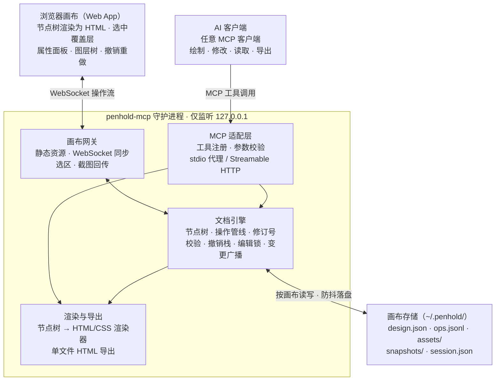

# AI Design 画布（MCP 驱动）技术 PRD

> 更新于 2026-11-10 · 在线版本：https://claude.ai/artifact/1Awid3TEZDhMp8MqY8rwFW

## 1. 概述

本产品是一个跑在本地的设计画布：AI 通过 MCP 工具在画布上绘制和修改 UI 稿，用户在同一画布上手动微调，完成后 AI 可再通过 MCP 读回设计稿做前端开发，也可导出 HTML 分享。本文档只定义方案，不含实现。

**核心决策：设计稿的唯一事实来源是一棵带稳定 id 的抽象节点树，HTML 只是它在画布上的展示形式。** AI 读写的都是节点（按 id 或组件名寻址），不直接读写 HTML；画布把节点树渲染成 HTML/CSS 交给浏览器排版，导出时用同一个渲染器。理由：抽象节点让 AI 可以按需读取局部而不是整页标记，也让“用户能改什么、AI 能改什么”可以按字段划清。

### 目标

| 编号 | 需求 | 验收标准 |
| --- | --- | --- |
| G1 | 本地画布服务器，AI 通过 MCP 绘制组件、调整样式与布局 | AI 仅用 MCP 工具即可从空画布生成一张完整页面稿，可逐节点修改；绘制时浏览器画布自动打开，AI 截图自检 |
| G2 | 用户在画布上手动调整样式、字体、盒模型 | 选中任一节点后可在属性面板修改盒模型、字体排版、颜色等与布局无关的属性，实时生效并落盘；位置与布局结构不可手动修改 |
| G3 | MCP 读取设计稿用于 UI 开发 | AI 按节点 id 或组件名读取结构、样式、设计令牌和截图，并能感知用户的手动改动 |
| G4 | 设计稿导出 HTML | 导出为单文件 HTML，离线双击打开；字体不随文件分发，接收方安装所列字体后与画布内渲染一致 |
| G5 | 画布与会话绑定存储 | 每个画布拥有独立设计稿；会话恢复后画布内容、历史与选区原样恢复 |

### 非目标（本期不做）

- 多人实时协作、云端同步、账号体系。
- 自由矢量绘图（钢笔、布尔运算）和图片编辑。
- 导入 Figma/Sketch 文件。
- 在产品内直接生成 React/Vue 等框架代码；框架转换交给读取设计稿的 AI 编码代理完成。
- 交互原型（页面跳转、动效时间线）。

### 核心场景

1. **AI 出稿**：用户在 Claude Code 里说“画一个登录页”，AI 调用 MCP 创建画板并插入节点，浏览器画布自动打开并实时出现设计稿，AI 截图自检后交付。
2. **人工微调**：用户在画布上选中按钮，把内边距改为 12/24、字体换成 Inter 600，改动即时保存。
3. **AI 续改**：用户说“把我选中的卡片改成横向布局”，AI 读取当前选区和用户改动后继续修改，不覆盖用户的手动调整。
4. **设计转开发**：用户说“按这张稿实现页面”，AI 按组件读取设计稿的结构、样式、令牌和截图，在项目代码里实现。
5. **分享**：用户点击导出，得到一个 HTML 文件发给他人。

## 2. 整体架构

系统只有一个写入方：本地守护进程里的文档引擎。AI（经 MCP）和用户（经浏览器画布）都只提交“操作”，由引擎校验、应用、编号、广播并落盘。



AI 的工具调用和用户的手动编辑汇入同一条操作管线；画布不直接改文档，只渲染引擎广播的结果。

### 进程与启动

- **守护进程（daemon）**：每台机器一个实例，持有所有已打开画布的文档状态，提供 HTTP（画布静态资源、导出下载）与 WebSocket（操作同步）。默认端口 4470，占用时递增，实际端口写入锁文件 `~/.penhold/daemon.json`。
- **MCP 入口**：客户端以 stdio 方式启动 `penhold-mcp`。该进程是薄代理：读取锁文件，守护进程不存在则拉起，然后把工具调用转发过去。这样多个 AI 会话可以共用一个画布服务，且浏览器地址稳定。同时支持直连守护进程的 Streamable HTTP 端点。
- **画布 Web App**：地址为 `http://127.0.0.1:<port>/c/<canvasId>`。AI 调用绘制工具时，若没有画布页面连接，守护进程自动用默认浏览器打开该地址。
- **生命周期**：没有任何 MCP 连接且没有浏览器连接超过 30 分钟后，守护进程自动退出；状态已全部落盘，下次启动按画布恢复。

### 技术选型

| 层 | 选型 | 说明 |
| --- | --- | --- |
| 运行时 | Node.js 20+、TypeScript | 前后端共用文档模型与操作定义（monorepo 中的 `core` 包） |
| MCP | 官方 TypeScript SDK，stdio + Streamable HTTP | 工具参数用 Zod 定义并生成 JSON Schema |
| 服务端 | Hono 或 Fastify + `ws` | 轻量；无数据库依赖 |
| 画布前端 | React + Vite，状态用 Zustand | 构建产物随 npm 包分发，由守护进程托管 |
| 渲染 | 每个画板一个 sandbox iframe | 样式隔离；布局由浏览器引擎计算，所见即导出 |
| 存储 | JSON 文件 + JSONL 操作日志 | 存放在用户目录；可读、便于排查 |
| 截图 | 画布页面内栅格化回传 | 绘制时浏览器必开，见第 4 节 |

### 取舍说明

- **为什么不用 Canvas/WebGL 自绘**：自绘需要自己实现文字排版和 flex/grid 布局，并且导出 HTML 时会出现不一致。iframe 内的真实 DOM 让画布、导出、开发读取三者结果一致。
- **为什么不用 CRDT**：只有一个用户和一个 AI，且都连到同一个本地进程。AI 修改期间画布对用户只读，服务端串行应用操作加修订号已经足够，实现成本低一个量级。

## 3. 设计稿数据模型

一份设计稿是一个 JSON 文档：若干画板，每个画板下是一棵抽象节点树，外加全局设计令牌和组件定义。节点不是 HTML 标签，而是带类型和分组属性的抽象对象；渲染器负责把它映射成 HTML/CSS。

### 结构

```ts
interface DesignDoc {
  schemaVersion: 1;
  canvasId: string;
  rev: number;                    // 每应用一次事务 +1
  tokens: Record<string, string>; // 设计令牌：颜色、字号、间距、圆角
  components: Record<string, ComponentDef>; // 组件定义，按组件名索引
  frames: Frame[];                // 画板（一个页面或一个组件稿）
  assets: Record<string, AssetRef>; // 图片资源
}

interface ComponentDef {
  name: string;                   // 如 “PrimaryButton”，画布内唯一
  root: Node;                     // 所有同名实例共用这一份结构与样式
}

interface Frame {
  id: string;
  name: string;                   // “登录页 / 桌面端”
  width: number;                  // 视口宽度，如 1440 / 390
  height: number | 'auto';
  root: Node;
}

interface Node {
  id: string;                     // 稳定 id，如 n_8fk2；AI 创建时可自带，缺省由服务端分配
  type: string;                   // 由 LLM 在创建时命名，如 “card”“switch”“table-row”，不是预置集合
  render?: 'container' | 'text' | 'image' | 'input'; // 渲染基元，缺省按字段推断
  name?: string;                  // 图层名

  component?: string;             // 填写后本节点是同名组件的实例，结构与样式取自组件定义
  overrides?: Record<string, { text?: string; props?: Record<string, string>; hidden?: boolean }>;
                                  // 实例级差异，按组件内部节点 id 索引

  layout?: Layout;                // 仅 AI 可写：方向、换行、对齐、gap、定位、伸缩
  box?: Box;                      // 用户可写：宽高、margin、padding、border、圆角
  style?: Style;                  // 用户可写：字体排版、颜色、填充、阴影、透明度
  props?: Record<string, string>; // src、alt、placeholder、href、图标名
  text?: string;                  // 用户可写
  states?: { hover?: Style; focus?: Style; active?: Style };

  children?: Node[];              // 结构与顺序仅 AI 可写
  meta?: { locked?: boolean; hidden?: boolean };
}
```

### 约束

- **属性按可写方分组**：`layout` 与 `children`（位置、顺序、层级）只接受 AI 的写入；`box`（含宽高）、`style`、`text` 用户和 AI 都可写。权限在文档引擎按字段校验，不依赖前端。
- **节点类型由 LLM 给定**：`type` 是开放字符串，AI 创建节点时自行命名，系统不预置类型集合。文档引擎记录已出现的类型名，在 `canvas_open` 中返回，引导 AI 沿用已有命名。
- **渲染只依赖四种基元**：渲染器不理解 `type` 的含义，只看 `render`（容器、文本、图片、输入）。缺省时按字段推断：有 `text` 为文本，有 `props.src` 为图片，其余为容器。任何类型都由这四种基元组合而成。
- **同组件名即复用**：组件名在画布内唯一对应一份定义。首次以某个组件名插入的子树成为定义；之后同名节点都是实例，只带 `overrides`。修改组件的结构或样式会同步到所有实例；文本、`props`、显隐可按实例覆盖。
- **属性是带类型的字段**，不是任意 CSS 字符串。`layout` 只表达自动布局（flex / grid 语义）；绝对定位仅用于角标、浮层等少数情况。
- **节点 id 稳定**：移动、改样式都不改变 id，AI 和用户可以跨多轮引用同一个节点。
- **设计令牌**：颜色、字号、间距、圆角以 `color.primary` 这类名字存放，属性值可引用令牌；修改令牌全局生效，开发读取时也能直接映射到项目主题。
- **字体只存名字**：`style.fontFamily` 记录字体族名称，文档和画布目录都不保存字体文件。
- **响应式本期不建模**：同一页面的桌面端和移动端是两个画板。

### 操作（Op）与事务

所有修改都表达为操作，一次工具调用或一次用户手势对应一个事务，事务原子生效。

| 操作 | 作用 | 可提交方 |
| --- | --- | --- |
| `insert` | 在指定父节点的指定位置插入子树 | AI |
| `remove` | 删除节点及其子树 | AI |
| `move` | 改变父节点或同级顺序 | AI |
| `set_layout` | 修改布局属性 | AI |
| `set_box` / `set_style` / `set_text` | 修改盒模型、视觉样式、文本 | AI、用户 |
| `set_props` / `rename` / `set_meta` | 修改属性、图层名、锁定与隐藏 | AI、用户 |
| `set_tokens` | 新增、修改或删除设计令牌 | AI、用户 |
| `frame_create` / `frame_update` / `frame_remove` | 画板的增改删 | AI |

每个事务记录 `rev`、`origin`（`ai` 或 `user`）、时间戳和逆操作，用于撤销、变更查询和崩溃恢复。

## 4. MCP 工具设计

工具分四组共 16 个：会话、绘制与修改、读取、导出。AI 的输入和输出都是带 id 的抽象节点，不出现 HTML；读取只能按节点 id 或组件名局部进行，没有“读取整份设计稿”的工具。

### 工具清单

| 分组 | 工具 | 作用 | 关键参数 |
| --- | --- | --- | --- |
| 会话 | `canvas_open` | 绑定或恢复画布，打开浏览器，返回 canvasId、URL、当前 `rev`、画板列表、已用类型名、组件名列表 | `canvas_id?`、`brief?` |
| 会话 | `design_preset` | 没有本地设计规范时的内置预设：不带参数返回内置规范全文与产品类型列表；按需求匹配产品类型；返回完整预设（色板令牌、风格、字体）并可记到画布 | `query?`、`id?`、`use?` |
| 会话 | `canvas_status` | 画布页面是否在线、用户当前选区、最新 `rev`、是否有待自检的改动 | 无 |
| 绘制 | `frame_create` | 新建画板，可同时给出初始节点树 | `name`、`width`、`height?`、`root?` |
| 绘制 | `frame_update` / `frame_delete` | 改名、改尺寸、删除画板 | `frame_id`… |
| 绘制 | `node_insert` | 插入一棵或多棵抽象节点子树 | `parent_id`、`index?`、`nodes[]` |
| 绘制 | `node_replace` | 用新的节点子树整体替换一个节点 | `node_id`、`node` |
| 绘制 | `node_update` | 批量修改节点字段，按字段合并 | `updates[]`：`{node_id, layout?, box?, style?, props?, text?, name?, component?}` |
| 绘制 | `node_move` | 调整层级或顺序 | `node_id`、`parent_id`、`index` |
| 绘制 | `node_delete` | 删除节点 | `node_ids[]` |
| 绘制 | `tokens_set` | 增改删设计令牌 | `tokens`：`{name: value \| null}` |
| 读取 | `design_outline` | 返回指定节点下的大纲：id、类型、组件名、图层名、子节点数 | `frame_id` 或 `node_id`、`depth?`（默认 2，最大 3） |
| 读取 | `design_read` | 返回指定节点或指定组件的完整字段 | `node_id` 或 `component`（二选一，必填）、`depth?` |
| 读取 | `design_changes` | 返回某个 `rev` 之后发生变化的节点 id 与字段，可只看用户改动 | `since_rev`、`origin?` |
| 读取 | `design_screenshot` | 返回画板或节点的 PNG，并附带文字版的溢出、重叠、尺寸检查结果；客户端不支持图片时仅凭文字结果自检 | `frame_id` 或 `node_id`、`scale?` |
| 导出 | `design_export` | 导出 HTML 到磁盘，返回文件路径和所需字体清单 | `frame_ids?`、`out_path?`、`inline_images?` |

### 关键约定

- **绘制输入是抽象节点树。** `node_insert` 接收第 3 节定义的 `Node` JSON，服务端按 schema 校验，未带 id 的节点由服务端分配。一次调用可插入一整个区块。校验失败时整次调用不生效，并指出出错节点和字段。
- **类型由 AI 命名。** `type` 是 AI 给的自由字符串，工具不校验其取值；`canvas_open` 返回画布中已用过的类型名和组件名，供 AI 保持一致。
- **同组件名即复用。** 插入时 `component` 是新名字，则该子树注册为组件定义；是已有名字，则只需给 `{component, overrides}`，子树取自定义。对已有名字又给出不同子树时拒绝，并提示改用 `node_update` 修改组件定义或换一个组件名。
- **改组件即改全部实例。** `node_update` 作用于组件内部节点时修改的是定义，返回中列出受影响的实例数量；要只改一个实例，写 `overrides`。
- **写工具统一返回** `{rev, affected: ["<id> <type>", "<id> <type><组件名>"], needs_check: true}`（紧凑 JSON），不回显节点内容。
- **绘制必须开浏览器并自检。** 写工具执行前检查是否有画布页面在线；没有则由守护进程用默认浏览器打开画布并等待连接，超时则报错而不是盲写。每轮绘制结束前，AI 必须对改动过的画板调用 `design_screenshot`；未自检时 `canvas_status` 持续报告待检查的画板。
- **AI 修改期间画布对用户只读。** 第一个写工具获取画布的编辑锁，详见第 5 节。
- **只能局部读取。** `design_outline` 有深度上限，`design_read` 必须给出节点 id 或组件名。超出 `depth` 的后代只返回 `{id, type, component}` 存根，需要时再按 id 继续读。
- **按组件名读取。** `design_read(component: "PrimaryButton")` 返回组件定义的完整字段，以及各实例的 id 与 `overrides`。
- **写前校验。** 写工具可带 `base_rev`。目标节点在 `base_rev` 之后被用户改过时，`node_update` 按字段合并，`node_replace` 和 `node_delete` 拒绝并返回变化的字段，让 AI 先读后写。
- **尊重锁定。** 用户锁定（`meta.locked`）的节点，AI 的写操作被拒绝并说明原因。
- **选区是一等公民。** `canvas_status` 返回用户当前选中的节点 id，支撑“把我选中的这个改成…”这类指令。
- **只用标准 MCP 能力。** 全部功能通过标准工具调用完成，返回文本和图片两种标准内容，不依赖任何客户端专有机制，以适配所有 MCP 客户端。

### 调用示例

```json
// node_insert
{
  "parent_id": "n_root1",
  "nodes": [{
    "type": "box",
    "component": "LoginForm",
    "layout": {"direction": "column", "gap": 16},
    "box": {"width": 360, "padding": 32},
    "children": [
      {"type": "text", "text": "登录",
       "style": {"fontFamily": "Inter", "fontSize": 24, "fontWeight": 600, "color": "{color.text}"}},
      {"type": "input", "component": "TextField", "props": {"placeholder": "邮箱"},
       "box": {"height": 44, "padding": [0, 12], "border": {"width": 1, "color": "{color.border}"}, "radius": 8}},
      {"type": "button", "component": "PrimaryButton", "text": "继续",
       "box": {"height": 44, "radius": 8},
       "style": {"background": "{color.primary}", "color": "#fff"}}
    ]
  }]
}

// 返回
{
  "rev": 12,
  "affected": [
    {"id": "n_a1", "type": "box", "component": "LoginForm"},
    {"id": "n_a2", "type": "text"},
    {"id": "n_a3", "type": "input", "component": "TextField"},
    {"id": "n_a4", "type": "button", "component": "PrimaryButton"}
  ],
  "needs_check": true
}
```

除工具外，另暴露两个 MCP resource：`design://<canvasId>/outline` 与 `design://<canvasId>/tokens`，供支持 resource 的客户端直接引用。

## 5. 画布手动编辑

画布是一个三栏编辑器：左侧图层树，中间画布，右侧属性面板。用户只能改节点的盒模型和与布局无关的属性，不能改位置、顺序和层级；这些结构性调整一律通过对 AI 提要求来完成。

### 渲染与选择

- 渲染器把每个画板的节点树转成 HTML/CSS，放入一个 sandbox iframe，元素带 `data-node-id`。引擎广播的操作以增量方式更新 DOM，不整页重绘。
- 选中框和盒模型高亮（margin / border / padding 分色）画在 iframe 之上的独立覆盖层，不污染设计稿 DOM。
- 单击直接选中鼠标下最深的元素，`Esc` 回到父级、`Enter` 进入首个子级；支持多选后批量改属性。
- 画布支持缩放（10%–800%）与平移。节点没有拖拽移动和尺寸手柄。

### 属性面板

| 分组 | 用户可编辑项 |
| --- | --- |
| 盒模型 | 可视化的四层盒图：margin、border、padding、content（宽高）；支持四边联动与单边编辑；圆角（四角独立） |
| 字体排版 | 字体族、字重、字号、行高、字间距、文本对齐、颜色、装饰线 |
| 填充与边框 | 背景色 / 渐变 / 图片、边框样式与颜色 |
| 效果 | 阴影、透明度、模糊 |
| 内容 | 文本、图片替换、占位文字、图标 |
| 设计令牌 | 修改令牌值；把颜色、字号、间距输入绑定到令牌 |

| 不可手动编辑（仅 AI） | 说明 |
| --- | --- |
| 位置与定位 | 无拖拽移动；`layout` 中的定位方式与偏移在面板中只读展示 |
| 布局结构 | 方向、换行、对齐、`gap`、伸缩比例只读展示 |
| 层级与顺序 | 图层树不可拖拽；不可新增、删除、复制、成组节点 |
| 画板 | 画板的增删与尺寸 |

数值输入支持拖拽调节和方向键步进。颜色、字号、间距输入框可绑定设计令牌，绑定后写入的是 `var(--token)`。

### 直接操作

- **文本**：双击文本节点原地编辑，失焦时提交 `set_text`。
- **盒模型**：在盒图中点击数值直接输入，或拖拽数值调节（含宽高）；画布上同步高亮受影响的区域。
- **组件联动**：选中的节点属于某个组件时，面板标出组件名和实例数。改盒模型和样式会同步到所有同名实例；改文本和图片只影响当前实例。
- **图层树**：选中、重命名、隐藏、锁定。
- **撤销与重做**：只作用于用户自己的改动。
- **交给 AI**：选中节点后可复制其 id 或组件名，用于在对话中指明要 AI 调整的对象。

### 字体

字体只以名称引用本机已安装的字体。字体选择器列出本机字体，也允许手动输入字体族名称；本机缺少某个已引用的字体时，画布用回退字体渲染并在该节点上标出缺失。产品不存储、不分发字体文件，也不访问网络字体服务。

### 与 AI 的并发

- **AI 修改时用户不可编辑**：AI 的第一个写工具获取画布编辑锁，画布进入只读，属性面板置灰并显示“AI 正在修改”。用户仍可缩放、平移和选中查看。
- **加锁时机**：用户正在输入的值先提交为一个事务，再加锁，不丢失用户已敲下的内容。
- **释放时机**：AI 完成本轮自检截图后释放；另设兜底，最后一次写入后 30 秒无新的写入则自动释放，避免 AI 中断后画布一直锁死。用户也可点击“终止并解锁”。
- **回退**：用户的撤销栈只回退用户自己的事务。另提供“回退 AI 上一轮改动”按钮，按 AI 一次持锁期间的全部写入整体回退。
- **改动回传**：用户改动带 `origin: user` 记录，AI 下一轮通过 `design_changes` 读到，避免把用户的调整覆盖回去。

## 6. 设计稿转代码（MCP 读取）

AI 编码代理通过读取类工具拿到四样东西：结构、样式、设计令牌、截图。本产品只负责把设计稿准确、省 token 地交出去，框架代码由代理结合目标项目的技术栈生成。

### 推荐读取流程

1. `canvas_open` 绑定画布，拿到画板列表和组件名列表。
2. `design_outline` 看目标画板的顶层结构，确定组件划分。
3. `design_screenshot` 取画板截图，作为视觉基准。
4. 逐个组件调用 `design_read`（按组件名或节点 id），读一个实现一个，不一次读入整页。
5. 实现完成后，可再次截图与自己的实现做对比。

### `design_read` 的输出

| 字段 | 内容 |
| --- | --- |
| `node` | 目标节点的抽象字段：`type`、`component`、`layout`、`box`、`style`、`props`、`text`、`states`，保留令牌引用 |
| `children` | `depth` 以内的后代完整给出，超出的只给 `{id, type, component}` 存根 |
| `instances` | 按组件名读取时：各实例的 id 及其 `overrides` |
| `tokens` | 该子树实际用到的设计令牌及其值 |
| `fonts` | 用到的字体族名称与字重 |
| `assets` | 图片资源的本地绝对路径，代理可直接复制进项目 |
| `computed` | 节点的实际渲染尺寸，由画布页面测量后回传 |

### 面向开发的处理

- **组件名是读取单位**：AI 绘制时即被要求为可复用块填写 `component`，开发时按组件名逐个读取，与代码中的组件一一对应。
- **不返回 HTML**：输出是抽象字段，代理据此写目标框架的代码，不会照抄画布的渲染结果。
- **去冗余**：未设置的字段不输出；同名组件只展开一份定义；隐藏节点默认不输出。
- **令牌优先**：输出保留令牌引用而不是展开后的色值，便于代理映射到项目已有的主题变量或 Tailwind 配置。
- **增量同步**：设计稿更新后，代理用 `design_changes(since_rev)` 拿到变化的节点 id，再按 id 读取并修改已有代码。

## 7. HTML 导出

导出物是一个可离线打开的单文件 HTML，由节点树经渲染器序列化得到，与画布内渲染使用同一份数据和同一个排版引擎，因此不存在还原度问题。导出格式只有 HTML。

### 入口

- 画布顶栏的“导出”按钮：选择画板和选项后下载。
- MCP 工具 `design_export`：写入指定路径，默认为画布目录下的 `exports/`。

### 导出选项

| 选项 | 默认 | 说明 |
| --- | --- | --- |
| 范围 | 当前画板 | 可选多个画板；多画板时生成带顶部切换条的单文件，或每画板一个文件的 zip |
| 图片内联 | 开 | 图片转 base64 嵌入；关闭时输出 `index.html` + `assets/` 的 zip |
| 样式形式 | class | 相同样式合并为 class 并写入 `<style>`；可选保持内联样式 |
| 画板宽度 | 固定居中 | 按画板宽度居中显示；可选铺满视口 |

### 序列化规则

- 导出与画布共用同一个渲染器，由抽象节点树生成标准 HTML5 文档，含 `viewport` meta 和一段最小化 reset。
- 设计令牌输出为 `:root` 上的 CSS 变量；`states` 输出为 `:hover`、`:focus`、`:active` 规则。
- 移除所有编辑器专用属性（`data-node-id`、锁定与隐藏标记）；隐藏节点不导出。
- 不含任何脚本（多画板切换条用纯 CSS 实现），接收方可安全打开。
- **不处理字体**：只输出 `font-family` 名称和通用回退族，不嵌入、不链接任何字体文件。导出结果和 HTML 文件头部注释中列出所需字体清单（族名与字重），由接收方自行安装。
- 导出前检查缺失的图片资源，在结果中给出警告。

导出的 HTML 不能再导入回画布继续编辑；需要交接可编辑稿件时，直接拷贝画布目录。

## 8. 会话绑定与存储

每个画布有一个自己生成的主键 `canvasId`，它是设计稿、操作历史、资源和视图状态的存储单元，落在本地磁盘的一个目录里。AI 对话会话不直接充当主键，而是作为别名指向 `canvasId`，因此会话的唯一性不依赖任何宿主提供的 id。

### 绑定规则

首次绘制时守护进程生成 `canvasId`（UUID），并在全局索引 `~/.penhold/index.json` 中维护“宿主会话 id → canvasId”的别名表，一个画布可挂多个别名。MCP 连接建立后按以下顺序找回画布，命中即停：

1. **对话内自带（主路径，适用所有 MCP 客户端）**：`canvas_open` 的返回里带 `canvasId`，它因此留在对话历史中。恢复会话后 AI 从上下文读到它并传回 `canvas_open(canvas_id)`。只用标准工具调用，不依赖客户端特性。
2. **别名命中（可选增强）**：客户端能提供宿主会话 id 时（如 Claude Code 的 SessionStart hook），上报的 id 在别名表中存在则直接绑定，省去 AI 传参。没有该机制的客户端不受影响。
3. **启动参数**：环境变量 `DESIGN_MCP_CANVAS`，用于手动固定到某个画布。
4. **兜底**：以上都没命中时，`canvas_open` 返回当前工作目录下最近的画布列表，由用户选择继续某一个或新建。

工具描述中要求 AI 在上下文中已有 `canvasId` 时始终传入。对话被压缩后 `canvasId` 可能从上下文中消失，此时由第 2 步或第 4 步承接。

**一个会话只能编辑一个画布。** MCP 连接一旦绑定某个 `canvasId`，此后所有工具调用都作用于它，工具参数里不再传画布 id；再次调用 `canvas_open` 传入另一个 `canvasId` 会被拒绝。一个画布内可以有多个画板。

**分叉会话共用同一个画布。** 分叉出的对话带着同一个 `canvasId`，绑定到同一份设计稿，不复制。因此一个画布可被多个连接绑定，写入由第 5 节的编辑锁串行化：同一时刻只有一个对话的 AI 持锁，其余对话的写工具等待或返回“画布正被另一会话修改”。

### 目录结构

所有数据存放在用户目录：`~/.penhold/canvases/<canvasId>/`，不写入项目仓库。全局索引 `~/.penhold/index.json` 记录每个 `canvasId` 的标题、关联的工作目录和别名表。

```text
<canvasId>/
├── session.json      # 元数据：canvasId、标题、创建/更新时间、工作目录、宿主会话别名列表、schemaVersion
├── design.json       # 设计稿最新快照（第 3 节的 DesignDoc）
├── ops.jsonl         # 追加写的事务日志：rev、origin、操作、逆操作、时间戳
├── ui.json           # 画布视图状态：缩放、平移、选区、面板展开
├── snapshots/        # 检查点与用户命名的版本：<rev>.json
├── assets/images/    # 图片，按内容哈希命名（不存字体文件）
└── exports/          # 导出的 HTML
```

### 写入与恢复

- **写入**：每个事务先追加到 `ops.jsonl`，再更新内存文档；`design.json` 在改动停止 1 秒后以“临时文件 + 重命名”的方式原子覆盖。
- **检查点**：每 200 个事务写一份快照并截断日志；用户可手动保存命名版本并回滚到任一版本。
- **恢复**：打开画布时读取 `design.json`，再重放 `ops.jsonl` 中 `rev` 更大的事务。守护进程崩溃最多丢失最后一个未写完的事务。
- **独占**：守护进程对打开的画布目录持有锁文件，防止两个进程同时写同一份稿。
- **升级**：`schemaVersion` 不一致时先备份再迁移，迁移函数随版本发布。

### 画布管理

- 画布首页 `http://127.0.0.1:<port>/` 列出所有画布，支持重命名、复制、删除。
- 删除为移入 `~/.penhold/trash/`，不直接抹除；不做自动过期清理。
- 画布目录自包含，可整体拷贝或打包迁移到另一台机器。

## 9. 非功能需求、里程碑与风险

### 非功能需求

| 类别 | 要求 |
| --- | --- |
| 安全 | 只监听 `127.0.0.1`；画布 URL 与 WebSocket 带随机访问令牌并校验 `Origin`；AI 输入按节点 schema 校验，不接受任何 HTML；画板 iframe 使用 sandbox 且不允许脚本 |
| 隐私 | 默认零外网请求：不加载远程字体、图片和统计脚本；远程图片在插入时下载到 `assets/` |
| 性能 | 单画板 2000 个节点内交互流畅；单次操作从提交到画布更新低于 100 ms；`design_outline` 在 1 秒内返回 |
| 可靠性 | 事务原子生效；崩溃后最多丢失一个事务；画布断线后自动重连并按 `rev` 补齐 |
| 兼容性 | macOS、Linux、Windows；画布支持最新两版 Chrome / Edge，其他浏览器尽力而为；MCP 侧适配所有支持 stdio 或 Streamable HTTP 的客户端，不依赖客户端专有机制 |
| 分发 | 单个 npm 包，`npx penhold-mcp` 即可作为 MCP server 启动，无原生依赖 |

以上性能数字是设计目标，需在 M1 结束时用真实稿件测量后修订。

### 里程碑

| 阶段 | 内容 | 验收门槛 |
| --- | --- | --- |
| M1 AI 能画 | 守护进程 + MCP 代理；文档引擎与操作管线；浏览器画布 + 截图自检；绘制与大纲读取工具 | AI 从空画布画出完整登录页 |
| M2 人能改 | 选中与覆盖层；属性面板 · 盒模型；字体 · 文本编辑；撤销重做 · 图层树；编辑锁 | 手动改动落盘且 AI 能读到 |
| M3 能交付 | `design_read` 精简输出；截图 · 变更查询；单文件 HTML 导出；图片内联 · 字体清单 | AI 按稿实现页面，导出件离线可开 |
| M4 能恢复 | canvasId 绑定规则与别名表；快照与命名版本；崩溃恢复 · 迁移；画布管理页 | 重启后画布与历史原样恢复 |

每个阶段以验收门槛为准入下一阶段的条件。M1 先用单一默认画布和最简落盘跑通“AI 画 → 画布显示”的闭环，完整的会话绑定与历史放在 M4。工期未估算，待确定人力后补充。

### 风险与对策

| 风险 | 影响 | 处理方式 |
| --- | --- | --- |
| 用户手动改乱布局 | 稿件结构失控，难以转代码 | 手动编辑只开放盒模型和与布局无关的属性；位置、顺序、层级仅 AI 可写，由引擎按字段校验 |
| AI 看不到渲染结果 | 溢出、重叠、错位无法发现 | 绘制时自动启动浏览器画布，每轮绘制后强制截图自检；浏览器连不上时写工具报错 |
| AI 生成不受控的标记、读取消耗过多 token | 稿件不可编辑，设计转代码质量下降 | AI 只读写带 id 的抽象节点，schema 校验；只能按节点 id 或组件名局部读取；HTML 仅用于画布展示和导出 |
| MCP 协议不传递宿主会话 id | server 不知道当前是哪个会话 | 画布自有主键 canvasId，宿主会话 id 只作别名；AI 从对话历史中传回 canvasId 是适用所有客户端的主路径，hook 上报别名是可选增强，都能绑回原画布 |
| AI 与用户同时修改 | 改动互相覆盖，元素在用户手下跳变 | AI 修改期间画布对用户只读，自检完成或超时后解锁 |
| 导出件中的字体授权与体积 | 分发存在版权问题，文件膨胀 | 导出不包含字体，只列出所需字体清单，接收方自行安装 |

### 已确认的决策

| 问题 | 结论 |
| --- | --- |
| 宽高是否允许手动改 | 允许，归入盒模型 |
| 分叉会话 | 共用同一个 `canvasId`，不复制画布 |
| 一个会话几个画布 | 只允许编辑一个画布 |
| 存储位置 | 用户目录 `~/.penhold/` |
| 节点类型 | 由 LLM 在创建时给定，不预置集合 |
| 渲染基元 | 第一期按四种基元（容器、文本、图片、输入）实现 |
| 组件复用 | 同组件名即复用同一份定义 |
| 目标客户端 | 所有 MCP 客户端 |
| 无图片能力的客户端 | 自检接受只用文字版的渲染检查结果（溢出、重叠、尺寸） |
| 导出范围 | 只导出 HTML |

### 待决问题

暂无。工期待确定人力后补充。
